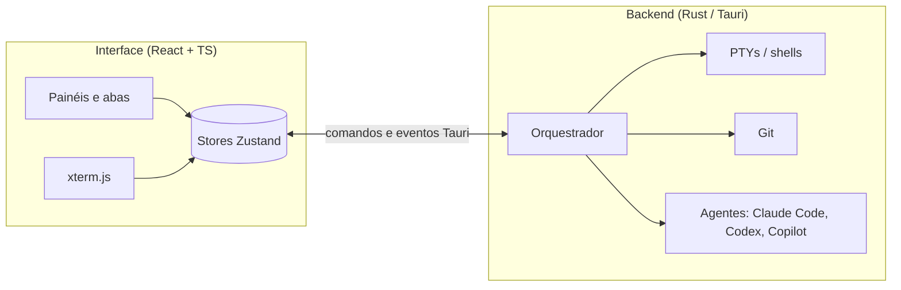

<div align="center">

# Alethe — fork de estudos

**Workspace multiagente para programar com IA: Claude Code, Codex, Copilot e terminais lado a lado, num app desktop local.**

Fork **não oficial** de [Kc1t/alethe-agents](https://github.com/Kc1t/alethe-agents), mantido por [Victor-Enginner](https://github.com/Victor-Enginner) para estudar arquitetura de UI multiagente e servir de base para uma interface própria.


<sub>Captura do projeto original. As capturas deste fork entram aqui conforme as mudanças forem feitas.</sub>

</div>

---

> [!NOTE]
> Este repositório **não é o Alethe oficial** e não tem relação com o autor original.
> O nome e a marca "Alethe" pertencem a Kauã Miguel (ver [TRADEMARK.md](./TRADEMARK.md)).
> O código segue a licença [AGPL-3.0](./LICENSE). A documentação completa do projeto original
> está em [README.upstream.md](./README.upstream.md).

## Sumário

- [O que é](#o-que-é)
- [Stack](#stack)
- [Arquitetura](#arquitetura)
- [Como rodar](#como-rodar)
- [Problemas encontrados](#problemas-encontrados)
- [Modificações deste fork](#modificações-deste-fork)
- [Roadmap](#roadmap)
- [Sincronizar com o original](#sincronizar-com-o-original)
- [Créditos e licença](#créditos-e-licença)

## O que é

Um app desktop que junta vários agentes de código e terminais numa janela só, com painéis
redimensionáveis, orquestração entre agentes, explorador de arquivos com Git, navegador
embutido e sistema de plugins. Tudo roda localmente.

## Stack

| Camada | Tecnologia | Papel |
|---|---|---|
| Shell desktop | **Tauri 2** (Rust) | Janela nativa leve, acesso a PTY, sistema de arquivos e processos |
| Backend | **Rust** (~48 mil linhas) | Terminais, orquestrador, Git, integração com agentes |
| Interface | **React + TypeScript** (~98 mil linhas) | Painéis, abas, sidebar, preferências |
| Estado | **Zustand** | Stores de projetos, terminais e workspace |
| Terminal | **xterm.js** | Emulação de terminal com links, busca e Unicode 11 |
| Componentes | **Radix UI**, **lucide-react**, **react-resizable-panels** | Diálogos, ícones, layout em painéis |
| Build | **Vite 6** | Dev server e bundle da UI |
| Testes | **Vitest**, testes Rust, **e2e** | 142 arquivos e 1073 testes de UI passando |

## Arquitetura



| Pasta | Conteúdo |
|---|---|
| `src/` | Interface React: componentes, stores, hooks, plugins |
| `src-tauri/src/` | Backend Rust: orquestrador, terminais, comandos Tauri |
| `e2e/` | Testes ponta a ponta |
| `docs/` | Documentação e capturas do projeto original |
| `scripts/` | Utilitários de build e release |

## Como rodar

Pré-requisitos: **Node 22+**, **Rust** (stable) e, no Windows, o **Build Tools do Visual Studio** com C++.

```bash
npm install
npm run app        # abre o app em modo dev (a primeira compilação do Rust demora)
npm test           # testes da UI (vitest)
npm run test:rust  # testes do backend
```

## Problemas encontrados

Problemas reais que apareceram ao rodar o projeto e como foram resolvidos.

| # | Problema | Causa | Status |
|---|---|---|---|
| 1 | `tauri dev` falha com *"Found version mismatched Tauri packages"* | O `Cargo.lock` resolve `tauri-plugin-notification` 2.4.0 e `tauri-plugin-updater` 2.12.0, mas o `package.json` pedia 2.3.3 e 2.10.1 | ✅ Corrigido: pacotes npm alinhados (`~2.4.0` e `~2.12.0`) |
| 2 | Build Rust falha com *"failed to read plugin permissions … os error 3"* depois de mover a pasta | `src-tauri/target` guarda caminhos absolutos da pasta antiga | ✅ Resolvido com `cargo clean` (não é bug do projeto: vale para qualquer projeto Tauri movido de lugar) |
| 3 | O `npm test` do repositório pai rodava os testes deste projeto com `node --test` e gerava 118 falhas falsas | Os testes daqui usam **vitest**, não o runner do Node | ✅ Corrigido no repositório pai (aqui os testes sempre passaram) |

## Modificações deste fork

Registro de tudo que muda em relação ao original. Cada mudança entra aqui e no Git, no mesmo commit.

| Data | Mudança | Commit |
|---|---|---|
| 14/10/2026 | Fork criado; README novo em português; README original preservado em `README.upstream.md` | `0c4affb` |
| 14/10/2026 | Plugins Tauri do npm alinhados com o Rust (problema #1) | `ee95291` |
| 14/10/2026 | **Fundo da home em carrossel de receitas ASCII** (adaptadas do [21st.dev](https://21st.dev/community/ascii)): Robot + Human, Mosaic e Vapor Halftone, com troca a cada 12 s e cross-fade. O motor `ascii-effect` ganhou a animação `shimmer` e os modos `mosaic` (blocos) e `dots` (halftone); vinheta, grão, bloom e tint são camadas CSS. Receitas em `src/components/HomeView/asciiRecipes.ts` | `0ba5d76` |
| 14/10/2026 | **Carrossel passa a usar exports em vídeo do 21st**, com a arte idêntica à da galeria: 3 slides ASCII verdes + Van Gogh (Starry Nights), em loop local em `src/assets/home-bg/` (a CSP bloqueia mídia remota). As receitas ao vivo continuam disponíveis em `asciiRecipes.ts`, fora do carrossel | *este commit* |

## Roadmap

Plano de 12 meses, com trabalho diário: da fundação a uma UI multiagente própria e, depois, uma DAW com agentes.
Detalhes em **[docs/fork/ROADMAP.md](./docs/fork/ROADMAP.md)**. Diário, decisões e marcos (pontos salvos) em **[docs/fork/](./docs/fork/README.md)**.

| Fase | Período | Foco |
|---|---|---|
| 0 ✅ | out/2026 | Fundação: fork rodando, docs, marco 0, carrossel ASCII |
| 1 | meses 1-2 | Dominar o código |
| 2 | meses 2-4 | Identidade própria: nome, logo, tema |
| 3 | meses 4-8 | Multiagente de verdade e performance |
| 4 | meses 8-12 | Rumo à DAW |

Pendências pequenas:

- [ ] Capturas de tela deste fork rodando no Windows
- [x] Carrossel ASCII no fundo da home: 4 artes, incluindo Van Gogh
- [ ] Mais mudanças de interface (a definir)
- [ ] Nome e identidade visual próprios (exigência da política de marca do original para versões modificadas)

## Sincronizar com o original

```bash
git fetch upstream
git merge upstream/main
```

`origin` aponta para este fork e `upstream` para [Kc1t/alethe-agents](https://github.com/Kc1t/alethe-agents).

## Créditos e licença

- Projeto original: **[Alethe](https://github.com/Kc1t/alethe-agents)**, de Kauã Miguel e contribuidores.
- Código sob **AGPL-3.0-or-later** ([LICENSE](./LICENSE)). Este fork mantém a mesma licença, e qualquer versão distribuída precisa publicar o código-fonte.
- A marca "Alethe" não é licenciada por este fork ([TRADEMARK.md](./TRADEMARK.md)).
