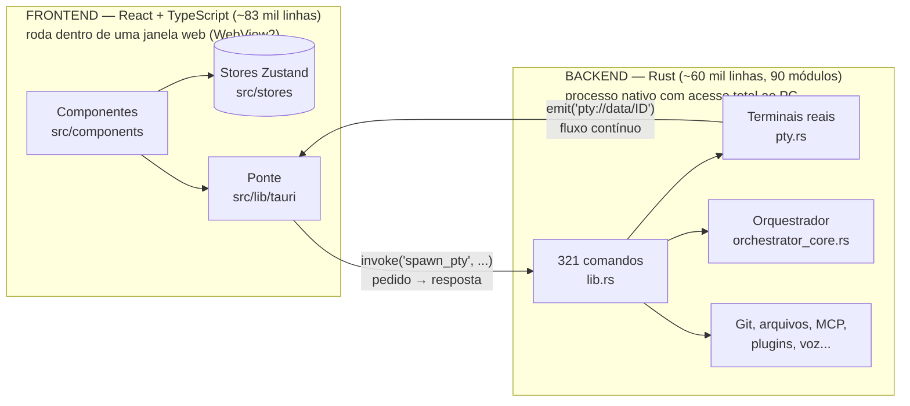
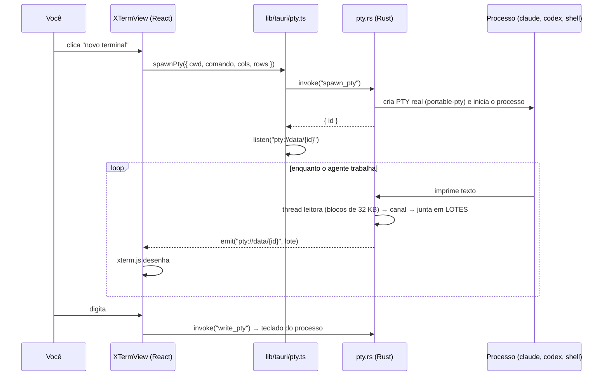
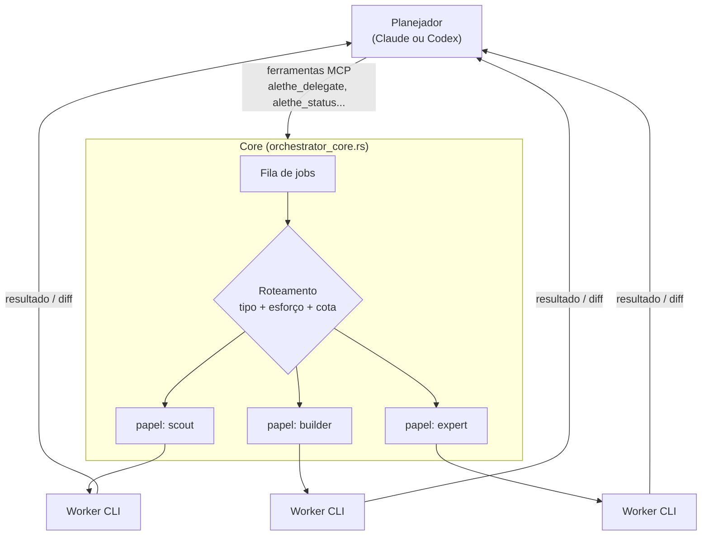

# Arquitetura do Alethe — guia de estudo

Mapa do código, do geral ao detalhe. Feito para ler aos poucos: cada seção termina com
**onde olhar no código** e **o que estudar**. Levantado em 15/10/2026 sobre a v1.7.0.

> Documentos do autor que complementam este guia: [`AGENTS.md`](../../AGENTS.md) (regras da casa),
> [`docs/OVERVIEW.md`](../OVERVIEW.md) (modelo de domínio), [`docs/FEATURES.md`](../FEATURES.md),
> [`docs/PLUGINS.md`](../PLUGINS.md), [`docs/ORCHESTRATOR_ROADMAP.md`](../ORCHESTRATOR_ROADMAP.md).

---

## 1. A ideia em uma frase

Um app desktop em que **cada terminal é uma unidade persistente** (pasta, abas, histórico,
processo) e onde **um agente "planejador" pode delegar tarefas para outros agentes**, tudo
orquestrado localmente.

## 2. As duas metades

O Alethe é um app **Tauri**: duas metades em linguagens diferentes, conversando por mensagens.



| Metade | Faz | Não pode |
|---|---|---|
| **Frontend** | Desenha tudo, guarda o estado da interface, reage a cliques | Abrir processos, ler disco livremente (é uma página web isolada) |
| **Backend** | Cria terminais reais, roda agentes, mexe em Git e arquivos | Desenhar interface |

**Os dois canais de comunicação** (a coisa mais importante para entender o resto):

1. **`invoke`**: o frontend *pede* algo e espera resposta. Ex.: `spawnPty(...)` → o Rust cria o
   terminal e devolve o `id`. São 321 comandos, registrados em `src-tauri/src/lib.rs`.
2. **eventos (`emit` / `listen`)**: o Rust *empurra* dados sem ninguém pedir. Ex.: cada pedaço de
   texto que um agente imprime chega como evento `pty://data/{id}`.

**Onde olhar:** `src/lib/tauri/pty.ts` (o lado TS da ponte), `src-tauri/src/lib.rs` (registro
dos comandos e o que liga junto com o app).

## 3. Modelo de domínio: as peças

```text
Grupo                       ← coleção de projetos (pode ter subgrupos)
└── Projeto                 ← unidade de trabalho: terminais, layout, cor
    └── Terminal            ← persistente: pasta (cwd), abas, scrollback
        ├── Sub-aba Shell
        ├── Sub-aba Claude Code     ← cada sub-aba = um processo (PTY)
        └── Sub-aba Codex
```

Na tela: um **Projeto aberto** vira um **Container**, e cada **Terminal** dentro dele é um
**Pane** (painel) no grid.

**Onde olhar:** `src/lib/types.ts` (os tipos), `src/stores/projectsStore*.ts` (o estado).

## 4. Fluxo principal: abrir um terminal com um agente

É o caminho que mais vale a pena entender de ponta a ponta.



**Detalhes de engenharia que valem estudo** (todos em `pty.rs`):

- **Thread leitora + canal (`mpsc`)**: uma thread só lê o processo e manda os bytes por um canal;
  outra tarefa junta e emite. Assim, um agente que imprime muito não trava a interface.
- **Emissão em lote**: 1 evento por lote, em vez de 1 por linha. Menos mensagens entre as metades.
- **Terminal invisível não emite**: se o painel não está na tela, o texto se acumula em
  `activity_pending` (até 256 KB) e só um aviso de "atividade" sobe. É assim que dezenas de
  agentes rodam sem pesar.
- **Scrollback em disco**: o histórico vai para arquivos `.bin`, por isso ele volta quando você
  reabre o app.
- **Suspender/retomar**: `suspend_pty` libera RAM de terminais parados.

**Onde olhar:** `src/components/XTermView/useXtermSession.ts` (linha ~1318, a chamada
`spawnPty`), `src-tauri/src/pty.rs` (`spawn_pty` na linha ~272, a thread leitora a partir da
linha ~488).

## 5. O orquestrador multiagente

A parte que faz do Alethe um ambiente de **squads de agentes**.



**Como funciona:**

1. Um agente **planejador** (Claude Code ou Codex) recebe um conjunto de **ferramentas MCP** do
   Alethe: `alethe_delegate` (delegar tarefa), `alethe_status`, `alethe_check`, `alethe_diff`,
   `alethe_steer` (corrigir o rumo), `alethe_cancel`, `alethe_answer`, `alethe_open_shell`...
2. Quando ele delega, a tarefa vira um **job** numa fila, com o ciclo
   `queued → running → (waiting / blocked) → done / failed / cancelled`.
3. Um **roteador** escolhe o **papel** (`Role`) que executa: `scout` (explorar), `typist`
   (digitação mecânica), `builder` (implementar), `writer` (texto), `deep` / `expert` (difícil).
   Cada papel define **qual agente**, **qual modelo**, **esforço**, se é **somente leitura**,
   **timeout** e um **fallback**.
4. **Regras de roteamento** (`RoutingRule`) combinam tipo de tarefa, esforço e **portões de cota**
   (`QuotaGate`): por exemplo, "se o Claude estiver com menos de 20% da cota semanal, use o Codex".
5. Os workers são CLIs reais iniciados por **launchers** (um por backend: `codex`, `claude`...).

**Decisão de arquitetura notável:** `orchestrator_core.rs` **não depende do Tauri** (só `std` +
`serde_json`). Isso permite testá-lo isoladamente (`src-tauri/tests/orchestrator.rs`) e até rodá-lo
como binário separado (`src-tauri/src/bin/`). Separar o núcleo da interface é uma lição valiosa
para o seu próprio projeto.

**Onde olhar:** `orchestrator_core.rs` (`Role` ~l.114, `RoutingRule` ~l.175, `Core` ~l.872),
`orchestrator.rs` (comandos que a UI chama), `orchestrator_rules.rs`, `orchestrator_shells.rs`,
`src/components/OrchestratorPane/` (a tela).

## 6. Estado e persistência (frontend)

- **Zustand** guarda o estado em *stores*. O principal é `projectsStore`, dividido em fatias
  (`projectSlices`, `terminalSlices`, `workspaceSlices`).
- Tudo é salvo em `projects.json` com **debounce** (espera parar de mexer) e **escrita atômica**
  (grava num `.tmp` e renomeia, para nunca corromper no meio).
- O formato é **versionado com migrações** (`projectsStore.migrations.ts`): quando a estrutura
  muda, dados antigos são convertidos.
- Cada **perfil** tem sua pasta isolada em `%APPDATA%\Alethe\profiles\<id>\`.

**Onde olhar:** `src/stores/projectsStore.ts` e as fatias; `src/stores/terminalsStore.ts`.

## 7. Mapa das pastas

### Frontend (`src/`)

| Pasta | Arquivos | Linhas | O que tem |
|---|---|---|---|
| `components/` | 195 | ~46 mil | Toda a interface (46 componentes de primeiro nível) |
| `lib/` | 146 | ~24 mil | Lógica sem UI: ponte Tauri, i18n, tipos, provedores de agentes |
| `stores/` | 19 | ~8 mil | Estado global (Zustand) |
| `plugins/` | 17 | ~3 mil | Plugins embutidos (ex.: todos) |
| `hooks/` | 23 | ~2 mil | Hooks React reutilizáveis |

Componentes-chave: `WorkspaceView` (grid de painéis), `XTermView` (terminal), `HomeView`
(início), `OrchestratorPane` (squads), `ProjectSidebar`, `RightSidebar`, `TitleBar`, `McpPanel`,
`DiffPane` / `PullRequestReview` (Git), `WebPane` (navegador embutido).

### Backend (`src-tauri/src/`), por família

| Família | Módulos principais |
|---|---|
| Terminais | `pty`, `process_tree`, `wsl`, `ghostty_bridge` (renderizador nativo opcional) |
| Orquestração | `orchestrator*`, `handoff`, `planning`, `planning_gate`, `scheduler`, `supervisor` |
| Agentes e uso | `claude_*`, `codex_*`, `opencode_*`, `cursor_sessions`, `agent_cost`, `agent_events`, `cli_resolver` |
| MCP | `mcp_store`, `mcp_agents`, `mcp_catalog`, `mcp_health`, `mcp_model` |
| Git | `git_control`, `worktrees`, `conflict_resolution`, `merge_analyzer`, `github_*` |
| Recursos | `resources`, `resource_manager` (controle de RAM) |
| Extras | `browser_pane` / `cdp` (navegador), `speech*` (voz), `spotify`, `skills`, `plugins*`, `graphify`, `ai_memory`, `remote` (controle pela LAN) |

## 8. Trilha de estudo sugerida (Fase 1 do roadmap)

Uma etapa por vez. Em cada uma: ler, rodar, mudar algo pequeno, anotar no DIARIO.

| # | Tema | Meta prática |
|---|---|---|
| 1 | Tauri: `invoke` e eventos | Criar um comando Rust `ola(nome)` e chamá-lo de um botão |
| 2 | Fluxo do PTY (seção 4) | Seguir um `spawnPty` com `console.log` / `eprintln!` dos dois lados |
| 3 | Zustand e persistência | Achar onde um terminal novo entra em `projects.json` |
| 4 | Layout e componentes | Mudar algo visual no `WorkspaceView` respeitando os tokens de tema |
| 5 | Orquestrador (seção 5) | Rodar uma delegação real e ler os testes em `src-tauri/tests/orchestrator.rs` |
| 6 | MCP | Entender como o planejador recebe as ferramentas `alethe_*` |
| 7 | Plugins | Fazer o `docs/examples/hello-plugin` funcionar |

Pré-requisitos que aceleram: noções de **Rust** (ownership, threads, `Arc<Mutex>`), **React
hooks**, e o que é um **PTY** (pseudo-terminal).

## 9. Regras do autor que o fork ainda não segue (dívida)

O `AGENTS.md` define regras da casa. As mudanças de 14/10 quebraram algumas. Vale corrigir
para facilitar receber atualizações do original e, quem sabe, contribuir de volta:

- [ ] Comentários de código em **inglês** (os do carrossel estão em português).
- [ ] **Sem cores fixas** no código: usar tokens de `src/styles/theme.css` (as receitas e as
  camadas CSS usam hex direto).
- [ ] Registrar features em `docs/CHANGELOG.md` (seção `[Unreleased]`).
- [ ] Textos visíveis via `t()` com as 3 traduções (o carrossel não tem texto, então está ok).

As regras de commit (sem co-autor, só com permissão) valem para o repositório do autor. Neste
fork, quem decide é o Victor.

## 10. Hermes e OpenClaw: agentes autônomos (Bloco 2)

### 10.1 Papel de cada um

O Alethe é a **mesa de trabalho**: você presente, orquestrando código. Hermes e OpenClaw são
**agentes que trabalham sozinhos, 24h**, acionados por chat (WhatsApp, Telegram, Discord), mesmo com
você longe do PC.

```text
                      VOCÊ
          ┌────────────┴────────────┐
     no PC (presente)         no celular (longe)
          │                         │
     ┌────▼─────┐          ┌────────▼──────────────┐
     │  ALETHE  │          │  HERMES · OPENCLAW     │  ← sandbox Docker
     │ orquestra│          │  agentes autônomos 24h │
     │ o código │          │  WhatsApp · Telegram   │
     └────┬─────┘          └────────┬──────────────┘
          └────────────┬────────────┘
                  ┌────▼────┐
                  │ 9router │  ← mesmos combos e provedores
                  └─────────┘
```

| | Hermes Agent (Nous Research, MIT) | OpenClaw (MIT) |
|---|---|---|
| Ponto forte | **Memória persistente e aprendizado**: cria habilidades a partir do que faz | **Gateway central + canais + sub-agentes** |
| Papel no sistema | Assistente de operações: lembra do projeto, resume o trabalho dos agentes, responde dúvidas sobre DIARIO, TAREFAS e DECISÕES | Central de automações: pipeline da série 100 dias, monitoramentos, tarefas agendadas, protótipo do canal WhatsApp da Bina |
| Modelos | Qualquer endpoint compatível com OpenAI → **9router** (combos) | Idem → **9router** |
| Risco | Muitas permissões (shell, arquivos, mensagens) | Idem |

Usos planejados:
1. **Série 100 dias (OpenClaw):** "gera o roteiro do dia 15" pelo celular → roteiro, narração e thumbnail para aprovar.
2. **Memória do projeto (Hermes):** "o que falta na sprint 1.4?" respondido de qualquer lugar.
3. **Protótipo do canal da Bina (OpenClaw):** testar conversa no WhatsApp antes da stack própria do
   Franca Atende. Só protótipo: dados de clientes e prefeitura ficam na stack própria.

### 10.2 Isolamento (não negociável)

- Rodam **só em containers Docker**, nunca direto no Windows.
- Volume montado **apenas** com a pasta de trabalho de cada um (ex.: `O:\data\agentes\hermes`), nunca `C:\` ou `O:\` inteiros.
- Sem acesso ao Docker socket do host.
- Segredos (tokens de bot, chave do 9router) via arquivo `.env` fora do Git.
- Uma chave de API do 9router **só para eles** (`hermes`, `openclaw`), revogável sem afetar o Alethe.

### 10.3 Lacuna: ponte Docker → 9router

O 9router escuta só em `127.0.0.1:41010` (correção de segurança do fork). Dentro de um container,
`127.0.0.1` é o próprio container, não o PC. Opções, da mais simples para a mais trabalhosa:

| # | Opção | Como | Expõe na rede de casa? | Status |
|---|---|---|---|---|
| 0 | `host.docker.internal` | O Docker Desktop encaminha `host.docker.internal:41010` para o host. Verificar se alcança serviço preso ao loopback | Não | 🧪 **testar primeiro** |
| 1 | Ponte restrita à interface do Docker | Proxy TCP pequeno escutando só no IP da interface virtual do Docker/WSL + regra do Firewall do Windows aceitando só a sub-rede do Docker | Não (se o firewall estiver certo) | plano B |
| 2 | 9router dentro do Docker | Rede Docker privada com 9router + agentes; o Alethe aponta para a porta publicada em `127.0.0.1` | Não | plano C (perde a gestão pelo Alethe) |

Critério de aceite: o container fala com o 9router **e** o IP da rede da casa (`192.168.x.x:41010`)
continua recusado (mesmo teste da verificação de segurança).

### 10.4 Ordem de entrada

1. Docker Desktop ligado e testado (já instalado, com WSL2 e Ubuntu 24.04)
2. Ponte Docker → 9router (opção 0, depois 1 se precisar)
3. **Hermes** (um agente só, mais simples)
4. **OpenClaw** (gateway, canais, sub-agentes)
5. Comparar e definir quando usar o orquestrador do Alethe, o Hermes ou o OpenClaw (decisão D-007)
## 11. Quem trabalha no orquestrador (levantado em 16/10/2026)

- O orquestrador só sabe iniciar **dois tipos de worker**: Codex (`codex app-server --stdio`) e
  Claude (`claude -p ... --permission-mode bypassPermissions`) — `orchestrator_core.rs`, `Launcher`.
- Esses workers rodam **direto nas contas** (assinatura do Claude, conta do Codex), **sem o 9router**:
  o orquestrador não injeta `ANTHROPIC_BASE_URL`/`OPENAI_BASE_URL`.
- Papéis (Configurações → Orquestração) escolhem agente, modelo, esforço, somente leitura, orçamento
  e fallback (troca quando a cota passa de 80%). Presets de roteamento: Economia, Equilibrado,
  Desempenho, Personalizado.
- **Atualização 17/10/2026:** `agy` e `opencode` entram como workers "um processo por turno"
  (`Launcher.one_shot`, ver [PROPOSTA-LAUNCHER.md](./PROPOSTA-LAUNCHER.md)). O OpenCode alcança os
  combos do 9router (`-m 9router/alethe-rapido`) com a chave injetada só no ambiente do worker.
  Freebuff continua fora (a CLI não tem modo não interativo).
